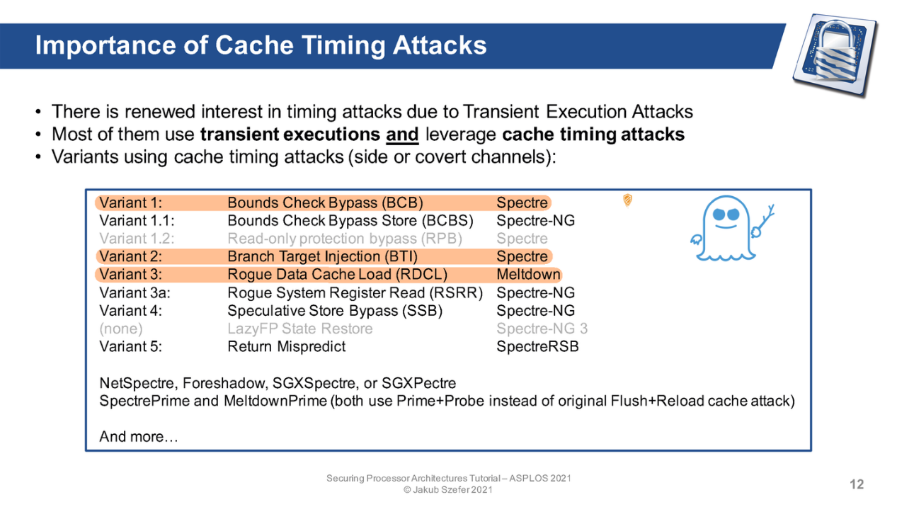
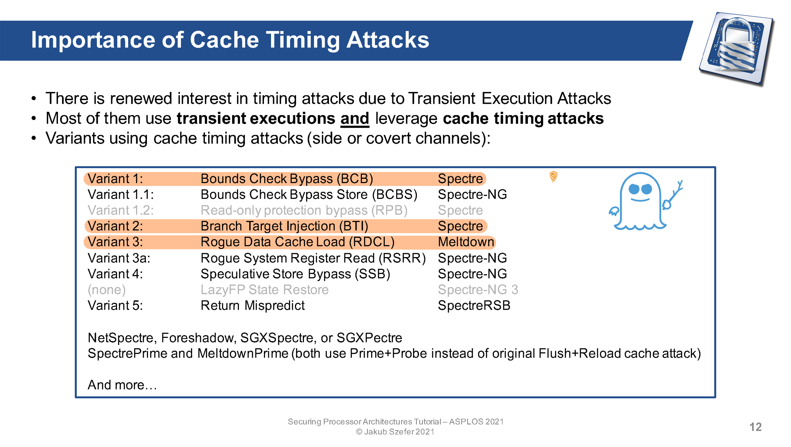
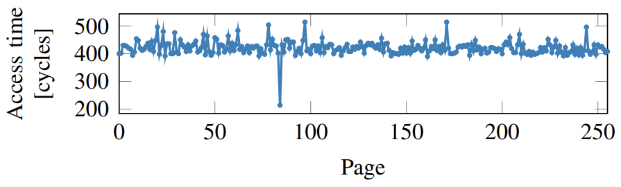
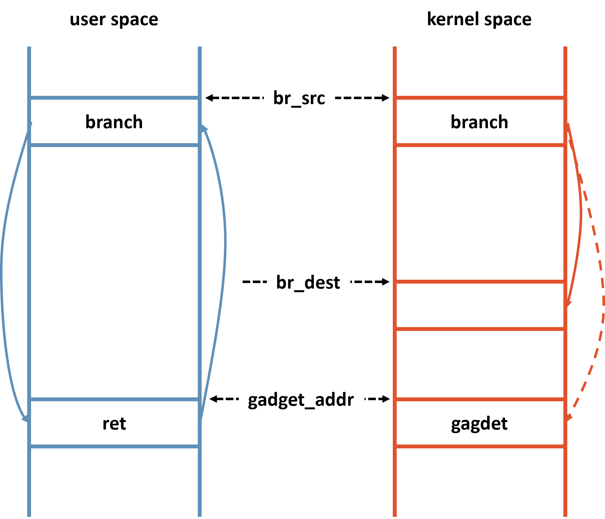
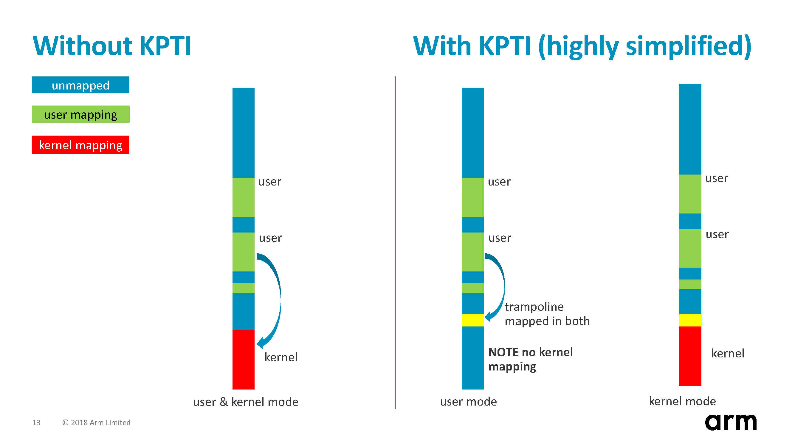
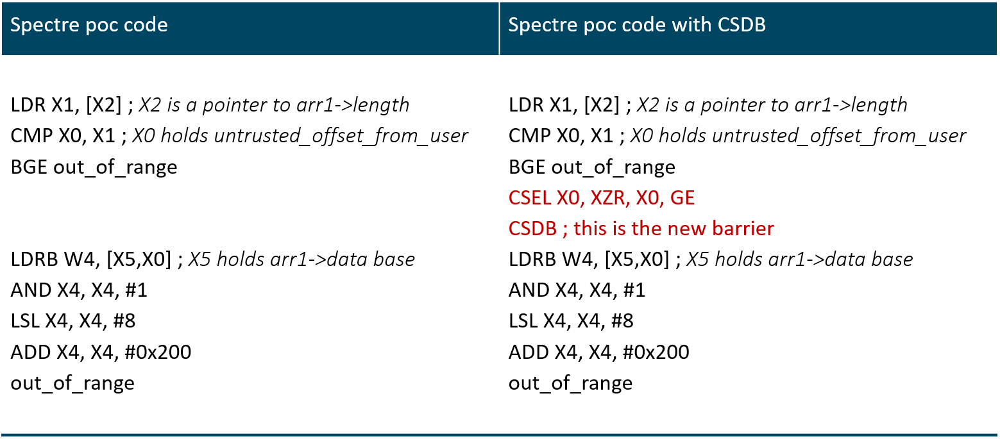
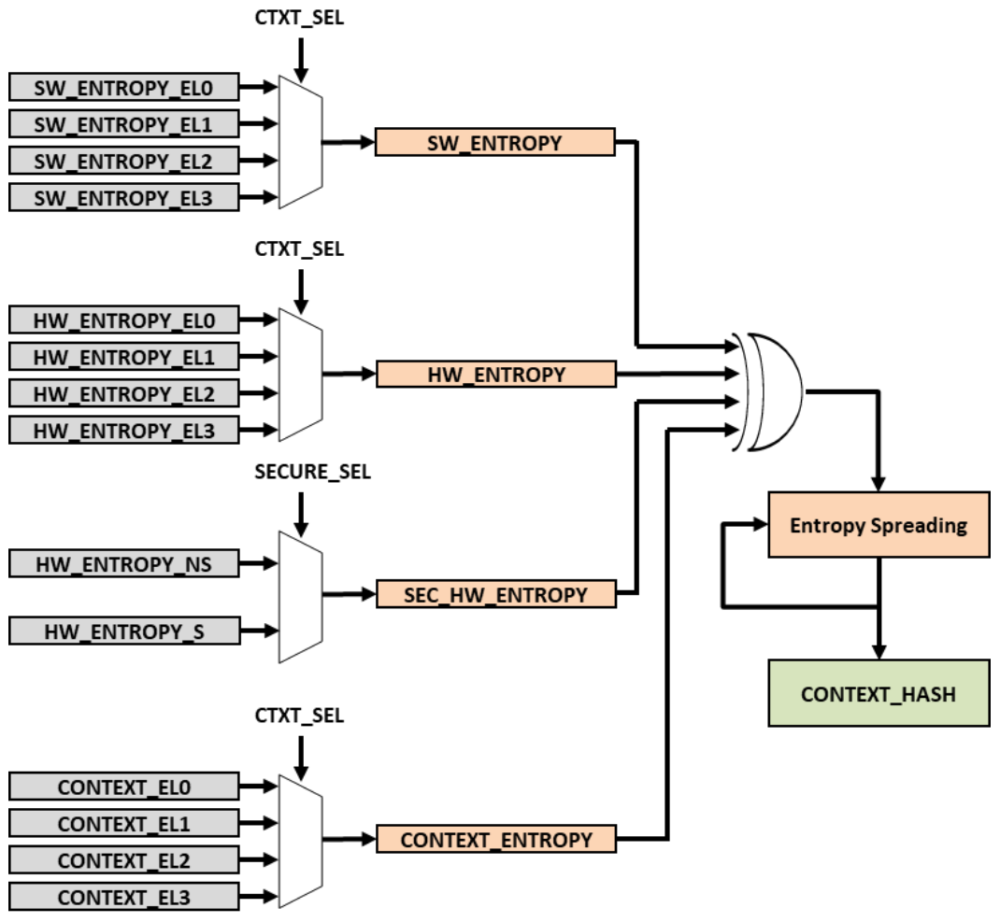

> This blog is also available in Chinese in https://zhuanlan.zhihu.com/p/699794849

This is the second of two articles introducing security features in Arm architecture. For the background of this series, please refer to the [first article](/posts/2024/06/security-extensions-in-arm-architecture/).

Meltdown and Spectre are clearly better known than ROP/JOP. Another distinction is that the vulnerabilities exploited by ROP/JOP essentially arise from missing security mechanisms in the memory models of high-level languages such as C, whereas Spectre and Meltdown uncover purely hardware-level vulnerabilities that are widespread in modern processors.

Meltdown and Spectre were originally introduced in these two papers[^1][^2], and both subsequently developed many other variants. This article focuses on the content of the original papers, as their variant numbers 1, 2, and 3 also indicate.



In general, all three attacks aim to obtain sensitive information. The name Meltdown describes this most vividly: it "melts" the isolation between user and kernel space. Like most articles on this subject, we will explain how the attacks work by walking through the papers' PoC (Proof of Concept) code.

## 1 Meltdown

Since this series focuses on Arm architecture, the PoC code written in x86 assembly in the original Meltdown paper is translated into Arm assembly below:

```asm
LDR X3, [X4] ; X4 points to some privileged memory
LSL X3, X3, #imm
LDR X5, [X6,R3] ; X6 is an non-privileged base address
```

This is one of the simplest representations of Meltdown, with the check for whether the loaded data is zero omitted. The attacker wants to obtain the data at the kernel-space address held in X4 while running in user space. The first instruction directly attempts to access a kernel-space (EL1) address. From the programmer's perspective, this access will be blocked because of insufficient permissions, raise an exception, and interrupt the instruction stream.

Although this will eventually happen, the processor can still obtain the kernel-space data internally before that point. There are two main reasons:

- User space can access the page tables for kernel space. Although the access will fail after the page-table information is checked, the kernel address mappings are visible to user space. This design, which seems to contradict OS isolation principles, is motivated by kernel performance. System calls from user mode are common, and retaining kernel address mappings for all processes incurs less overhead than remapping them on every transition between user and kernel mode.

- The MMU obtains the PA and memory attributes together, and permission checking happens afterward. Although it might seem reasonable for an MMU fault to invalidate the PA directly, exceptions are handled centrally at the final commit stage. During the window between detecting an exception and handling it, some designs may allow the memory access to continue with its fault information and forward the result to subsequent instructions.

If either of these conditions is absent, the processor is naturally immune to Meltdown, which also points toward possible mitigations. Among Arm's designs to date, all large, medium, and small cores other than certain revisions of the A75 are unaffected by Meltdown[^3].

The second reason above implies another requirement: the window before exception handling must be long enough for the malicious code to execute and complete the attack. In an in-order processor, this window is at most the distance between the EX stage, where the exception occurs, and the commit stage, where it is reported, which does not exceed 10 cycles. In an out-of-order processor, the instruction window greatly expands this interval; theoretically, its maximum can equal the size of the instruction window, potentially reaching more than 100 cycles.



The instruction window is an abstraction of outstanding instructions in an out-of-order processor. Its size determines the degree of parallelism and also implies an area cost. Within this window, instructions are completely out of order. At a higher level, as illustrated above, we can imagine the window sliding along a long instruction stream, continually taking in new instructions for decoding and retiring old instructions in order. This preserves consistent execution from the programmer's perspective.

Subsequent instructions perform computations using this kernel data, but do not modify architectural state. At the exposed hardware/software interfaces, the programmer sees no unexpected behavior. For this code, software can therefore only observe an exception through conventional means, without perceiving any effect of the subsequent instructions on the processor. However, thanks to another performance-oriented design in the processor, instructions that actually executed leave traces. By deliberately recovering these traces, an attacker can infer that the instructions executed.

The component with this security implication is the cache, which exists in various forms and at various levels of the processor. Caches act as snapshots of the data accessed by instructions, particularly the load operations commonly used in malicious code. Since the data in these structures is not architectural state, cache changes are not undone when the processor recovers from an instruction that should not have executed.

Meltdown exploits precisely this behavior: kernel data that existed internally but remained invisible to the programmer leaves a trace in a covert channel such as the cache, and the attacker recovers that trace. The third instruction demonstrates this: it uses the kernel data as an address offset, adds it to a legal base address in user space, and accesses the resulting address. What that address contains does not matter; what matters is that it was accessed. The access fills a cache line and a TLB entry for the corresponding page, making the access latency of that address or page distinguishable from other addresses. By finding the address with the lowest access latency among the legal candidates, a process that can be performed in the exception handler, the attacker can reconstruct the kernel data used to form it.

In the paper, the authors construct a probe array of 256 * 4096 bytes. The number 256 represents the range of possible kernel-data values: the paper loads an 8-bit value, hence 256 possibilities. In this example, a 64-bit value is loaded, so the corresponding number would be 2^64. The 4096-byte stride is a disambiguation measure corresponding to the second instruction. It inserts a stride of 4096 between possible values, effectively increasing their spacing. Imagine that we omit this step and use only a one-dimensional array. After executing the PoC code, traversing the array again would reveal three levels of access speed:

- slowest：address with TLB miss and cache miss

- middle：address with TLB hit and cache miss

- fastest：address with TLB hit and cache hit

The kernel data falls into the fastest category, but because a cache line is wider than a single load, several addresses following it exhibit the same access speed and cannot be distinguished. Expanding the array to 256 * cache-line size avoids placing multiple candidates in the same cache line, but processor prefetching may cause a similar problem. The authors therefore expand the stride to an entire page. Of course, such regular loads might still trigger prefetching, but their results suggest that this did not occur. With this arrangement, only two levels of access speed remain:

- slowest：address with TLB miss and cache miss

- fastest：address with TLB hit and cache hit

The kernel data now uniquely occupies the fastest category and stands out clearly from all the other addresses, completing the attack. Finally, the following experimental result from the paper demonstrates this difference in access speed:



## 2 Spectre

### 2.1 Spectre v1

Spectre is very similar to Meltdown: it also attempts to access kernel addresses and uses a covert channel to disclose the corresponding data. Spectre's cleverness lies in inducing the kernel itself to access the desired address from user mode. Since the kernel has full access permissions for kernel addresses, Spectre is not even blocked by permission checking and therefore does not trigger an exception.

```c
if (x < array1_size)
  y = array2[array1[x] * 4096];
```

For Meltdown, we can regard the entire PoC sequence as user-space code. The Spectre PoC instead represents a kernel-space function, potentially found in a library. If the user can pass arguments to this function and has access to array1 and array2, all the conditions required for the attack are in place. Since array2 resides in user space, user access to it is natural. Meanwhile, array1 resides in kernel space: for some reason, the user has access to the legitimate address range of array1, and the attacker wants to abuse that access by extending it to the entire kernel address space.

Spectre v1 is also called bounds check bypass. The kernel function intends to use bounds checking to constrain user access to kernel space, checking that a variable is within the agreed range before using it. However, the conditional statement introduced by the bounds check creates parallel paths. Since the branch direction determines subsequent instruction fetching, the processor must make a decision early, even before the condition is available, so the decision can only be speculative. The background on speculative execution is covered in the first article. Prediction is not completely random, but there is no great mystery to it either: most branch predictors simply rely on history, using past branch directions to predict future ones.

Spectre therefore executes the PoC code N times. By controlling x, the attacker makes legal accesses to array1 during the first N-1 executions, training the branch predictor to expect x to remain valid on the Nth execution. Before that final execution, however, the attacker changes x to an illegal value. An out-of-bounds array access is essentially an access to the array's base address plus an excessive offset. By controlling that offset, the attacker can access arbitrary kernel addresses.

As a result, while waiting for the branch to resolve, the kernel accesses the attacker-specified kernel address on a speculative path. Spectre also needs a sufficient execution window, so array1_size is evicted from the cache to delay branch resolution. Although the access result becomes invisible after the misprediction is discovered, the cache is polluted during the process, just as in Meltdown, and the subsequent disclosure follows naturally.

### 2.2 Spectre v2

Spectre has many variants. In terms of their targets, v1 attacks conditional branches, which are generally direct branches. The v2 variant discussed next attacks indirect branches among unconditional branches, expanding Spectre's attack surface.

A direct branch has a target calculated by adding or subtracting an immediate value from the current PC. This immediate is encoded in the instruction itself, so the target of a particular direct branch can be determined directly from the instruction. Processors improve prediction accuracy by recording relationships between branch instructions, identified by their addresses, and their targets. This structure is generally called the BTB (Branch Target Buffer).

An indirect branch takes its target from the value in a specified register, so a direct mapping from the instruction to its destination cannot be established. Simply replicating the BTB approach for these instructions may therefore be unsuitable. Nevertheless, because programs exhibit temporal and spatial locality, additional information, such as a GHR recording branch execution history, can improve BTB lookup accuracy for indirect branches. Modern processors generally have an IBTB (Indirect Branch Target Buffer) dedicated to indirect branches.

In a computer system, the OS creates virtual addresses and promises isolation between processes. The MMU marks processes with ASIDs in hardware, giving the same virtual address in different processes different mappings so that their TLB entries do not interfere. Perhaps because this was considered sufficient for process isolation, the various buffers in the branch unit do not make a similar distinction between processes. This gives attackers an opportunity to influence predicted kernel branch targets from user space.

Indirect branches also expose an attack surface similar to conditional branches. An attacker can evict the target address from the memory hierarchy, provided it can first be obtained by some means, creating a true data dependency on preceding instructions. This delays resolution of the indirect branch and forces speculative execution. Delaying a conditional branch's condition provides an execution window for the malicious code following it; an indirect branch instead redirects the instruction stream to a gadget. The gadget resembles the malicious code, using an attacker-controlled register to read from a specified memory address.

With these conditions in mind, we can outline Spectre v2 as follows:

- Obtain the address of the victim branch in kernel space, denoted br_src, with its actual target denoted br_dest.

- Scan library functions to find a gadget capable of disclosing data, and obtain its kernel-space address, denoted gadget_addr.

- Place an indirect branch at br_src in user space and set its target to gadget_addr.

- Place a RET instruction at gadget_addr in user space so that execution returns to br_src. The attacker repeatedly executes this loop to train the predictor, ensuring that both the GHR and BTB information in the IBTB are polluted. The kernel can subsequently use br_src to look up gadget_addr.

- Evict the target address of the kernel-space branch at src_addr and execute that branch, inducing the kernel to execute the gadget speculatively.

- Use a covert-channel attack to extract the data obtained by the speculatively executed gadget.



## 3 Mitigation

This section mainly discusses Arm's architectural mitigations for these vulnerabilities. Although most are defined in the Arm ARM, they guide microarchitectural implementation rather than defining architectural behavior involving data exchanges with GPRs or system registers. Since these attacks exploit performance structures inside the processor, the corresponding mitigations often depend on hardware-level restrictions on those structures. One exception is KPTI. Given its effectiveness against Meltdown, we will also discuss this software-level mitigation.

### 3.1 Kernel Page Table Isolation (KPTI)

As mentioned in the Meltdown discussion, kernel address mappings have long been made visible to user space to improve performance. The underlying issue is excessive information exposure: most programs need only the system-call interface, so exposing the kernel's other data structures is unnecessary. KPTI follows this reasoning by reducing user-visible kernel mappings to the minimum, retaining only a trampoline interface for system calls. Other kernel accesses cannot complete address translation because their mappings are absent, blocking Meltdown.



Before KPTI, kernel page-table entries also carried a Global hint, which forms part of the TLB tag and overrides the ASID that otherwise participates in the tag. An entry corresponding to a Global mapping can therefore be accessed by processes with any ASID. This is the hardware manifestation of making kernel mappings visible to user space. KPTI removes the Global hint from most kernel addresses and assigns ASIDs to them as it does for ordinary user processes, preventing user processes from hitting TLB entries for kernel addresses.

For a detailed explanation of the TLB, I recommend [this article](https://zhuanlan.zhihu.com/p/108425561).

### 3.2 FEAT_CSV3

As Figure 0-1 shows, Spectre/Meltdown-style attacks share a unified variant numbering scheme. Arm names its architectural mitigation features after these numbers, so the mitigation for Meltdown is called FEAT_CSV3 (Cache Speculation Variant 3).

FEAT_CSV3 defines the following three restrictions:

> - Data loaded under speculation with a Permission or Domain fault cannot be used to form an address, generate condition codes, or generate SVE predicate values to be used by other instructions in the speculative sequence.
> - Any System register read under speculation to a register that is not architecturally accessible from the current Exception level cannot be used to form an address, to generate condition codes, or to generate SVE predicate values to be used by other instructions in the speculative sequence.
> - Changes to System registers must not occur speculatively in a way that can affect a speculative memory access that can cause a change to the micro-architectural state.

Of these three rules, only the first directly relates to the Meltdown attack, variant 3, discussed here. The other two restrictions on system registers appear to target variant 3a. The first rule is straightforward: it is a microarchitectural restriction tailored to Meltdown. If a speculative load encounters an MMU fault, its data must not be used to generate addresses for subsequent memory-access instructions.

Implementing this rule does not require changes to the MMU or the lazy exception-handling mechanism. With KPTI disabled, the processor can still issue speculative accesses to kernel addresses, but the retrieved data will not be exposed through a covert channel.

As mentioned earlier, all large, medium, and small Arm cores other than certain A75 revisions are unaffected by Meltdown. This information comes from Arm's official security page[^3], which identifies A75 revisions before r3p0 as affected. Interestingly, comparing the A75 r2p1 and r3p0 TRMs reveals that the r3p0 Processor Feature Register includes a CSV3 identifier, whereas r2p1 does not.

### 3.3 Consumption of Speculative Data Barrier (CSDB)

Arm presents CSDB as a response to Spectre v1 in a security whitepaper[^4]. CSDB is a barrier instruction that restricts speculative execution. The Arm ARM defines it as follows:

> - Control flow speculation before and after the CSDB instruction.
> - Speculative execution of conditional data processing instructions after the CSDB instruction, unless they use the results of data value or PSTATE.{N,Z,C,V} predictions of instructions appearing in program order before the CSDB instruction that have not been architecturally resolved.

Before explaining it, let us look at another instruction that also restricts speculative execution but is not mentioned in the whitepaper: SB (Speculation Barrier), defined as follows:

> An SB instruction can complete when:
> - It is known that it is not speculative.
> - All the predicted data values generated by instructions appearing in program order before the SB instruction have their predicted values confirmed.

SB is evidently the stronger barrier: preceding instructions must be fully resolved before subsequent instructions are allowed to execute, almost completely disabling speculative execution. In comparison, CSDB prevents execution only when subsequent instructions would consume speculative data produced by earlier instructions. CSDB should therefore have a smaller performance impact than SB.

According to the whitepaper, CSDB should be used together with a CSEL instruction. For a Spectre v1-style attack, the speculative data is actually the condition used for the branch decision. CSEL turns this condition into unresolved data, shaping the datapath into a form where CSDB can take effect.



In the table's code, the attacker-controlled malicious address is held in X0, while the array-bound information is loaded into X1. This load causes a cache miss, so from the microarchitecture's perspective, X1 is unresolved, whereas X0 is a known value. First, consider the execution of the left-hand sequence:

- CMP remains pending because of a RAW hazard with LDR.

- BGE, a B.cond instruction depending on the GE condition, remains unresolved, but the processor predicts the branch and continues fetching and executing from LDRB.

- The X0 value used by LDRB is unaffected by the unresolved branch, so LDRB executes normally.

- If the window is long enough, the following AND, LSL, and ADD instructions execute as well.

- The branch resolves, LDRB through ADD are flushed, and BGE jumps to out_of_range to continue execution.

After CSEL is inserted, X0 becomes pending because of a RAW dependency on BGE: BGE updates the PSTATE flags forming GE, and CSEL depends on GE. LDRB in turn has a RAW dependency on CSEL. To some extent, this already appears sufficient to stop LDRB from executing. My guess is that Arm additionally requires CSDB because some microarchitectures might speculatively update PSTATE after branch prediction and allow subsequent instructions to consume it. In any case, with these two instructions, an attacker may still bypass the bounds check by mistraining the branch predictor, but cannot obtain kernel data because subsequent speculative execution is constrained.

### 3.4 FEAT_CSV2

As its name suggests, FEAT_CSV2 mitigates Spectre v2. It also has a series of subversions, such as FEAT_CSV2_2 and FEAT_CSV2_3, which are essentially refinements of FEAT_CSV2. First, consider the definition:

> If FEAT_CSV2 is implemented: Code running in one hardware-defined context (context1) cannot either exploitatively control, or predictively leak to, the speculative execution of code in a different hardware-defined context (context2), as a result of the behavior of any of the following resources:
> - Branch target prediction based on the branch targets used in context1.
> - This applies to both direct and indirect branches, but excludes the prediction of the direction of a conditional branch.
> - Data Value predictions based on data value from execution in context1.
> - Virtual address-based cache prefetch predictions generated as a result of execution in context1.
> - Any other prediction mechanisms, other than Branch, Data Value, or Cache Prefetch predictions.
>
> In this definition, the hardware-defined context is determined by:
> - The Exception level.
> - The Security state.
> - When executing at EL1, if EL2 is implemented and enabled in the current Security state, the VMID.
> - When executing at EL0, whether the EL1&0 or the EL2&0 translation regime is in use.
> - When executing at EL0 and using the EL1&0 translation regime, the address space identifier (ASID) and, if EL2 is implemented and enabled in the current Security state, the VMID.
> - When executing at EL0 and using the EL2&0 translation regime, the ASID.
>
> If FEAT_CSV2_2 is implemented, then SCXTNUM_ELx is also part of the hardware-defined context.

In the first part of the definition, the first rule targets Spectre v2 by preventing branch prediction data from being mixed across contexts. The definition uses the abstraction of a hardware-defined context to represent different processes and specifies its components. The reason for not relying on ASID alone may be that an ASID does not always uniquely identify a process, leaving a risk that two processes cannot be distinguished. The solution is to combine ASID with other hardware-visible process information, increasing the entropy of the identifier as much as possible.

As the definition shows, Arm first includes readily available architectural information: the Exception level, Security state, and VMID. FEAT_CSV2_2 additionally defines a special set of registers, SCXTNUM_ELx. If this feature is supported, their values also participate in the hardware-defined context.

FEAT_CSV2 can be implemented in several ways. The Samsung Exynos team's farewell paper[^5] provides one possible approach. It describes the hardware-defined context as a hash key called CONTEXT_HASH, invisible to software and computed entirely by hardware. Its entropy sources are the components listed in the definition. In the figure below, from top to bottom, these are SCXTNUM_ELx, the Exception level, Security state, and the ASID/VMID combination.



Samsung places CONTEXT_HASH in the IBTB/RAS lookup and update datapaths, XORing it with the branch target being written or read, effectively encrypting and decrypting it. If an attacker mistrains the branch predictor from CONTEXT A, the resulting IBTB value is usable only by CONTEXT A. Other processes use a different CONTEXT_HASH and therefore cannot recover a valid address, avoiding a jump to the malicious gadget.

## Reference

[^1]: https://meltdownattack.com/meltdown.pdf

[^2]: https://spectreattack.com/spectre.pdf

[^3]: https://developer.arm.com/Arm%20Security%20Center/Speculative%20Processor%20Vulnerability

[^4]: https://developer.arm.com/-/media/Arm%20Developer%20Community/PDF/Security%20Update%2008%20June%202020/Cache_Speculation_Side-channels-v2.5.pdf?revision=8670efef-4d6b-497b-ac1c-246fb343244e

[^5]: https://ieeexplore.ieee.org/document/9138988
