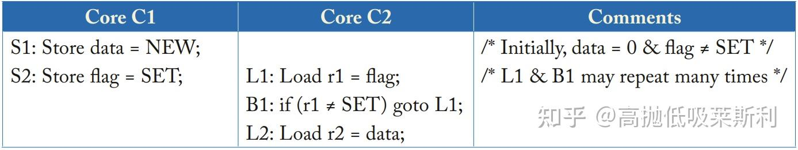
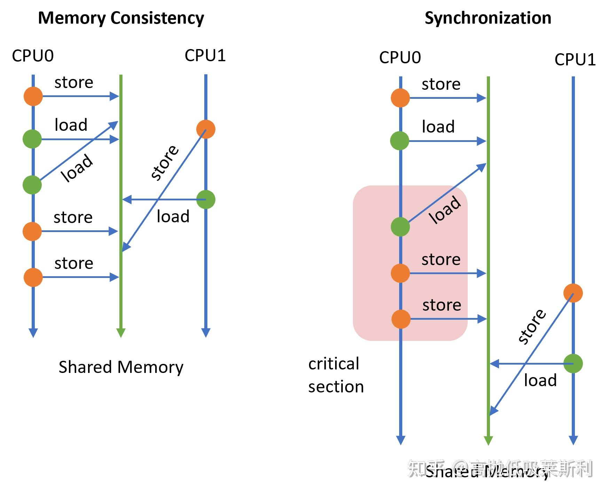
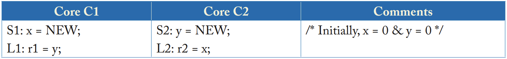
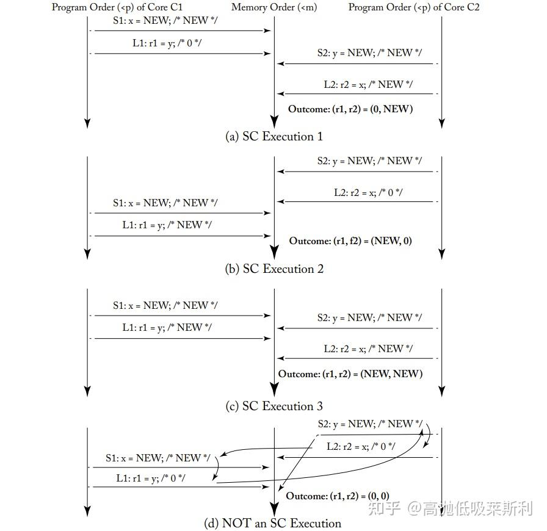
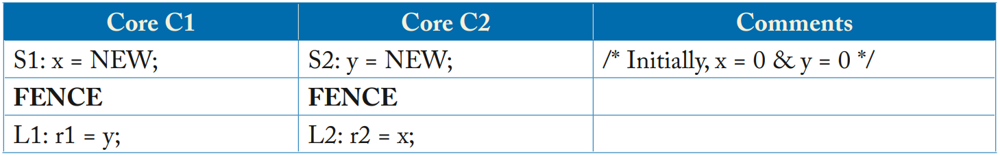
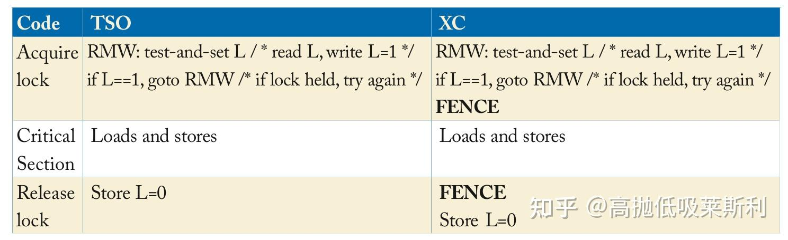
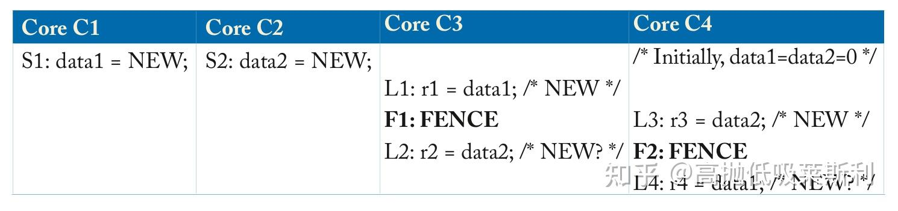

## Preface

I recently read *A Primer on Memory Consistency and Cache Coherence*, along with some further material it led me to, and decided to write down what I learned. I chose the title Shared Memory because this article focuses on memory consistency and synchronization, both of which address problems arising from shared memory access in multicore architectures. Before discussing shared memory, it is therefore worth briefly revisiting multicore architectures.

Since entering the CPU field, I have encountered and learned about multicore concepts here and there, but both my work and my spare-time study have remained focused on single-core design. Technology websites and individual bloggers also tend to concentrate on single-core microarchitecture: a new BP, an added MOP/uOP cache, a larger ROB, and so on. In fact, even as someone working in the field, I have to admit that CPU architecture is a field whose heyday has passed. Dark silicon had already pronounced a death sentence on multicore scaling in 2012, while single-core research has seen essentially no major breakthroughs since 2000. Modern superscalar microarchitectures are not fundamentally different from their predecessors around the time I was born. They all build on the same, even older ancestors: reservation stations (1967), register renaming (1975), branch target buffers (1984), and reorder buffers (1985).

Superscalar and multicore designs both aim to exploit parallelism, but in different ways: the former is usually called instruction-level parallelism (ILP), and the latter thread-level parallelism (TLP). Historically, ILP and TLP were not competing paths. TLP was the fallback when ILP had run out of road. Both academia and industry had every incentive to improve CPU performance with little or no impact on programming. The ingenuity and effort that went into CPU designs compatible with existing programs constituted the so-called free lunch for software engineers[^1].

Despite these enormous efforts, single-core design began to show its exhaustion in the twenty-first century, and its trajectory became unsustainable. On one hand, instruction streams in general-purpose applications contain only limited parallelism. Increasingly complex microarchitectures designed to exploit it offer rapidly diminishing returns and can even become a burden. Some literature reports that CPUs wider than four-issue bring very little benefit in most applications[^2], while Intel demonstrated that excessively deep pipelines were also the wrong direction. On the other hand, just as software quickly consumes any performance gain delivered by hardware, smaller transistor feature sizes have almost never translated into smaller chips: designers invariably find ways to fit more transistors into the same area to exploit the benefit. CPUs had to stop raising their clock frequencies before their power density started heading toward that of a nuclear reactor.

## 1 Memory Consistency

This article introduces memory consistency and synchronization in a more intuitive, though not necessarily completely accurate, way. Suppose several cores are running a program in parallel. We can imagine each core having its own sequence of memory operations in program order. These operations eventually act on shared memory; in other words, each core's private memory operations eventually become visible to all the other cores. From the perspective of shared memory, the operations from the different cores are interleaved in some way to form a global order.

If every core's memory accesses followed its program order exactly, there would be no need for memory consistency, or rather there would be only one memory model: Sequential Consistency (SC). However, preserving all this ordering costs performance, so CPU engineers have developed various optimizations to the memory-access microarchitecture. These optimizations **may** cause the order of the memory accesses issued by the CPU to differ from program order.

This difference means that a program's result **may** differ from what was expected. For example, in the code below, if memory accesses are allowed to depart from program order, S1, S2, L1, B1, and L2 can be interleaved in more than one way that prevents register r2 from receiving NEW as the program's semantics would suggest. S2 might execute before S1, for instance, or L2 might execute before all the other instructions.



*Table 1-1*

Adding a few restrictions, such as prohibiting stores from being reordered, reduces the possible executions but still does not guarantee r2=NEW. If loads are also prohibited from being reordered, the sequential semantics of this program can be fully guaranteed. This suggests the following interpretation: **memory consistency is a contract that constrains how hardware engineers design CPU memory-access behavior. It determines which memory-access reorderings are allowed and which are not, enabling programmers to anticipate the possible memory-access results of a program.**

Synchronization, meanwhile, is a programming practice used to ensure that particular critical sections of a program execute correctly. The need for such critical sections will be explained in the next subsection. We can think of this as requiring that the memory accesses within these critical sections not be interleaved. The following diagram illustrates and compares these two important concepts.



*Figure 1-1*

Different degrees of restriction on memory accesses produce different memory models. For CPU design, the memory model is an architectural choice, such as TSO for x86 or a relaxed memory model for Arm. The CPU microarchitecture and the interconnect must both obey that model's constraints and prevent illegal memory-access reorderings.

Like most blogs introducing memory consistency, this article presents several memory models in order of how strictly they constrain accesses. The difference is that we will emphasize the relationship between each model and CPU hardware design.

## 2 Sequential Consistency (SC)

SC is the most intuitive memory model. It requires the CPU to preserve all four memory-access orderings below. Thus, in shared memory with an SC implementation, memory accesses follow program order exactly: no load or store can bypass any other load or store.

- Load → Load
- Load → Store
- Store → Load
- Store → Store

This does not imply that an SC implementation permits only one interleaving of memory accesses. Every global order that respects each core's memory-access order is legal. For the code in Table 1-2, the first three orderings in Figure 1-2 are all SC-compliant.



*Table 1-2*



*Figure 1-2*

As mentioned earlier, the memory model shapes the microarchitectural design of the memory-access units. SC imposes an enormous performance penalty. Consider the most straightforward implementation: each load or store waits until the preceding load or store completes before starting execution. Every memory-access latency is then fully exposed.

**2.1 Implementing SC**<br>
Even with the strictest memory-order semantics, an SC implementation can tolerate some microarchitectural optimizations. This paper by Hennessy, one of the founding figures of our field[^3], presents two classic techniques: non-binding prefetch and speculative load.

***Non-binding prefetch***<br>
Non-binding prefetch hides part of the memory-access latency through a coherent cache system. It assumes an implementation capable of issuing multiple memory accesses. While one load or store executes, later memory instructions are prefetched. Accesses that would otherwise issue back to back and accumulate their latencies can then overlap to some extent within the multiple-issue window, hiding part of the latency. The prefetched cache lines are still consumed in program order, so SC is preserved.

> The existence of non-binding prefetch implies that binding prefetch also exists. The difference is that binding prefetch makes a firm commitment: subsequent instructions may directly use the prefetched value before the instruction associated with the prefetch completes. Non-binding prefetch makes no such guarantee. If the prefetched data might be updated during that interval, non-binding prefetch should be used.

Non-binding prefetch therefore requires prefetched values to remain within the cache hierarchy without changing architectural state, such as GPRs. This means that if a load or store's address calculation depends on the result of an earlier prefetch, that load or store cannot itself be prefetched.

The coherence protocol ensures the validity of prefetched copies in the cache hierarchy: if a snoop(A) from another CPU occurs between prefetch(A) and consumption(A), prefetch(A) becomes invalid and is invalidated or updated.

```text
lock L    (miss)        lock L    (miss)
write A   (miss)        read C    (miss)
write B   (miss)        read D    (hit)
                        read E[D] (miss)
unlock L  (hit)         unlock L  (hit)

Example 1               Example 2
```

The paper uses these two code examples to demonstrate the optimizations by comparing SC, RC (Release Consistency), and optimized SC and RC using non-binding prefetch or speculative load, denoted oSC and oRC below. Both examples use lock–unlock for synchronization. Thus, even under RC, the loads and stores between lock and unlock cannot be reordered across those boundaries, although they can be freely reordered within them.

> Since we have not reached Release Consistency yet, readers can focus on the comparison between SC and oSC for now.

Assume that a hit takes one cycle and a miss takes 100 cycles. For Example 1, the results are:

- SC: 301 cycles total (100+100+100+1).
- RC: 202 cycles total (100+100+1+1). After lock L completes, write A/B issue together, hiding write B's miss latency.
- oSC: 103 cycles total (100+1+1+1). lock L and the prefetches for write A/B proceed together, hiding the miss latencies of write A/B.
- oRC: 103 cycles total (100+1+1+1), for the same reason.

Prefetch appears to improve both SC and RC very effectively. Now consider Example 2. Its distinctive feature is the data dependency between read D and read E[D]. The expected performance under the four models is:

- SC: 302 cycles total (100+100+1+100+1).
- RC: 203 cycles total (100+100+1+1+1). After lock L completes, read C/D issue together. In the next cycle, when read D completes, the prefetch for read E[D] issues. The latencies of read D and read E[D] are hidden.
- oSC: 203 cycles total (100+1+1+100+1). lock L and the prefetches for read C/D proceed together, but the non-binding restriction prevents the prefetch for read E[D] from issuing before read D completes.
- oRC: 203 cycles total (100+1+1+100+1; the original paper says 202 here, and I do not know how it arrived at that number). lock L and the prefetches for read C/D proceed together. Although read D can be reordered to complete before read C, it cannot complete before lock L, so the prefetch for read E[D] cannot issue within lock L's miss window.

***Speculative load***<br>
The other optimization, speculative load, addresses precisely this problem of consuming prefetched values. It resembles speculative execution following branch prediction. If a prefetched value forms the address of a subsequent load, but not a store, that instruction can perform a speculative prefetch. If the prefetched value is found to be invalid, as checked by the non-binding prefetch system, the instruction associated with that prefetch and all subsequent loads are flushed and reexecuted, much as a CPU handles an incorrectly speculated path.

The paper introduces a Speculative-Load Buffer, separate from the reservation station, to track speculatively executed loads. Different memory models can also be supported by selecting entries from this buffer differently.

With both non-binding prefetch and speculative load enabled, Example 2 performs as follows:

- oSC: 104 cycles total (100+1+1+1+1). lock L and the prefetches for read C/D proceed together. In the next cycle, when read D is ready, the prefetch for read E[D] issues, hiding the latencies of read D and read E[D].
- oRC: 103 cycles total (100+1+1+1). lock L and the prefetches for read C/D triple-issue. Although read D can be reordered to complete before read C, it cannot complete before lock L, so the prefetch for read E[D] cannot issue within lock L's miss window.

## 3 Total Store Ordering (TSO)

SC preserves all four combinations of load/store ordering. As we will see later, the weakest memory models occupy the opposite extreme: they preserve none of those combinations. It seems natural to introduce a model with an intermediate degree of strictness here, and TSO is a typical example.

TSO is well known as the memory model used by x86. It relaxes Store → Load ordering, allowing a younger load to bypass an older store:

- Load → Load
- Load → Store
- Store ↔ Load
- Store → Store

Returning to the code in Table 1-2, the first three cases in Figure 1-2 comply with both SC and TSO. The fourth violates SC but still complies with TSO.

**3.1 Implementing TSO**<br>
From a hardware implementation perspective, many people associate TSO with the store buffer. In my view, the two are certainly related, but they are not identical. A store buffer's basic purpose is to move potentially long-latency stores out of the ROB early, reducing the impact of that latency on the retirement of other instructions. An implementation with a store buffer can still be SC, provided that loads in the ROB, rather than all instructions, wait for the store buffer to drain before executing. Such an implementation can at most gain the performance benefit of allowing other instructions between a store and the next load to retire earlier.

However, practical evaluations[^4] show that a store immediately followed by a load is common in most workloads. A store buffer therefore provides very limited gains in an SC implementation, whereas relaxing the memory model to TSO delivers substantial benefits.

Also, because TSO relaxes only Store ↔ Load ordering, store-buffer entries must remain FIFO-ordered to preserve Store → Store ordering.

**3.2 Safety net**<br>
Even when developers targeting a TSO implementation understand that TSO may violate a program's SC assumptions, they may still want to prevent such violations in certain programs. This requires a so-called safety net, usually a barrier instruction. Whenever this article discusses a non-SC memory model, we will also discuss its corresponding safety net.

TSO provides its safety net through FENCE instructions. When developers want to preserve Store → Load ordering, they must explicitly express that requirement by inserting a FENCE before the two operations. Hardware ensures that instructions after the FENCE do not bypass instructions before it. If ordering is required for the program in Table 1-2, inserting a FENCE as shown in Table 1-3 prevents case (d) in Figure 1-2, restricting execution to SC-compliant outcomes.



*Table 1-3*

One of the simplest ways to implement FENCE is to drain the store buffer before executing it. Loads younger than the FENCE, rather than all younger instructions, must also wait until the FENCE commits before executing.

## 4 Relaxed Memory Consistency

Beyond TSO, there are almost no further incremental memory models that relax only one or two additional memory orderings. Models known as relaxed consistency instead relax all three remaining orderings in one step. My guess is that relaxing Store → Load ordering provides the greatest microarchitectural performance improvement, exceeding even the combined gains from relaxing all three remaining orderings[^4].

The idea behind relaxed consistency is that all memory reorderings are permitted, and users should explicitly preserve any ordering they need in the relevant code regions with an appropriate safety net. Implementations in this framework can exploit memory-access performance to the fullest. The drawback is that vendors have not agreed on when ordering is needed or what properties the corresponding safety nets should have. This explains why relaxed consistency is so widespread among RISC CPUs, yet each instruction set has its own model.

> Before continuing, we should state an assumption that is often left implicit: memory ordering is relaxed while preserving the correctness of single-processor program semantics. Address, data, and control dependencies must still be handled correctly. For example, a value returned by a load may determine a later access's address or a store's data, while a branch condition determines which instruction results can ultimately take effect. Hardware can begin some of this work through speculation and cancel or reexecute it as necessary to ensure correct final results.

**4.1 Implementing relaxed consistency**<br>
Section 3.1 noted that a TSO store buffer requires FIFO entries. It is then easy to see that removing this FIFO restriction allows Store → Store ordering to be relaxed. Relaxed consistency uses a less constrained store buffer, though its control logic is actually more complex. It can select an eligible entry to make progress instead of always waiting for the oldest entry, reducing the extent to which that entry blocks the entire buffer.

Another related optimization is store coalescing, which allows stores that are not adjacent in program order to merge into the same buffer entry. Consider the following instruction stream:

```text
S1: store byte [A]
S2: store byte [B]
S3: store byte [A+1]
```

Suppose A and A+1 fall within the same supported aligned unit, such as a doubleword, while B falls within another aligned unit. If S1's entry has not been released and can still accept data, S3 may merge into it. Hardware can accumulate valid data through a byte mask, using the later store's value for overlapping bytes. This reduces entry occupancy and subsequent cache or bus accesses.

This merging means that writes originally located on either side of S2 can be processed together, clearly breaking Store → Store ordering.

Both optimizations introduce additional implementation complexity. Hardware must determine which entries have ordering relationships that must be preserved, and which entries still permit merging. In particular, when synchronization operations such as FENCE appear, stores after the boundary must be prevented from merging into entries before it. Otherwise, even if the drain logic respects the boundary, the merge itself may violate the ordering.

However, implementing relaxed consistency can also simplify hardware. As mentioned earlier, an SC implementation can execute loads early, but the data obtained early cannot unconditionally become the final result. Hardware must retain enough information to check whether the early execution still respects SC ordering and undo the result if necessary. Relaxed consistency can eliminate this logic. If the model already permits loads to two different addresses to exchange their read order, a value read early need not be discarded simply because it was obtained before an older load.

Larger performance gains may depend on an OoO core's larger instruction window and dynamic scheduling, which allow more independent loads to execute past blocking instructions. In an in-order core, the limited number of in-flight instructions usually constrains this opportunity, although a younger load may still obtain and temporarily hold its data while waiting for an older load.

**4.2 Safety net**<br>
We have already discussed barrier instructions under TSO and their role in explicitly constraining specified memory-access behavior. With relaxed consistency, the greater freedom to reorder instructions makes it especially important to consider how the weaker memory model can affect a program. The intuitive meaning suggested by an instruction sequence can sometimes obscure these effects.

Take a lock as an example. Under TSO, an atomic test-and-set can acquire the lock, and an ordinary store can release it. The RMW that acquires the lock has the required ordering with memory accesses in the critical section. The store that releases the lock also cannot bypass earlier loads and stores in that section. This sequence therefore needs no additional FENCE.

Under relaxed consistency, however, an atomic RMW still guarantees an atomic update to the lock variable, ensuring that only one core succeeds when multiple cores compete for the lock, but it does not by default constrain accesses in the critical section. A load or store following lock acquisition may move before it, and the store releasing the lock may bypass accesses in the critical section whose ordering has not yet been established. Compared with TSO, implementing a lock under relaxed consistency, denoted XC in the table, therefore incurs additional barrier overhead:



*Table 4-1 Synchronization in TSO vs. synchronization in RC*

Atomicity and ordering must therefore be considered separately. Atomic RMW resolves contention on the lock variable itself, while additional ordering constraints place the critical section's data accesses between the correct lock boundaries. The ordering effects of RMW in a stronger model cannot simply be carried over to a weaker model.

In fact, protecting this critical section does not require all ordinary accesses before acquire to remain before it, or all ordinary accesses after release to remain after it. The constraints actually needed in this example are **directional**.

***Acquire-Release***

As a specific model of release consistency, Release Consistency (RC), proposed at ISCA '90[^5], exploits precisely this property: it distinguishes acquire and release synchronization operations, providing ordering constraints toward subsequent and preceding accesses, respectively.

Acquire requires ordinary loads and stores that follow it in program order to also follow it in memory order. In the lock-acquisition example, accesses in the critical section cannot reorder across acquire before the lock has been successfully acquired. Acquire itself does not require earlier ordinary loads and stores to precede it, leaving those accesses some room to move later.

Release works in the opposite direction: ordinary loads and stores that precede it in program order must also precede it in memory order. In the lock-release example, the critical section's accesses must execute before the lock is released. Release itself does not require later ordinary loads and stores to follow it, leaving those accesses some room to execute earlier.

## 5 Arm Memory Model

The Arm memory model belongs to relaxed consistency and remains subject to single-processor dependencies, same-address orderings, and synchronization constraints.

Having followed the discussion this far, we should now have a fairly clear idea of the Arm memory model's consistency behavior. Here we will discuss two particularly confusing terms in its architecture: single-copy atomicity and multi-copy atomicity.

Single-copy atomicity specifies the granularity at which an access is observed as a whole by other observers. For example, an ordinary, naturally aligned 64-bit access in AArch64 has 64-bit single-copy atomicity. When one processor uses a 64-bit store to update a location from an old value to a new value, a corresponding 64-bit load by another PE reads either the complete old value or the complete new value.

The Arm memory model requires single-copy atomicity. This constrains how a load collects data from different paths. In particular, when partial forwarding occurs in parallel with a store progressing through the memory system, hardware must ensure that the assembled result still corresponds to a legal atomic access. If this cannot be guaranteed, forwarding can be disabled or the relevant accesses can wait.

Multi-copy atomicity concerns a quite different issue: the visibility of a store to multiple observers, and whether there is a common point at which the update becomes visible to them. Before this point, other cores may read the old value at the location. After it, they read the new value or a value written by a subsequent store.

The book uses the IRIW (Independent Read Independent Write) example to illustrate why this property matters. Consider a multicore system in which Core0 and Core1 write two independent locations, while Core2 and Core3 read them in opposite orders. Barriers preserve the load order within each core.



*Table 5-1*

Initially S1=S2=0. Consider the following outcome:

```text
Core2: r1 = NEW, r2 = 0
Core3: r3 = NEW, r4 = 0
```

Core2 reads the new value of x and then the old value of y, meaning that it has observed x's update while y's update is not yet visible to it. From its perspective, x's update must therefore precede y's. Core3 instead reads the new value of y and then the old value of x, requiring y's update to precede x's. The two observers thus imply opposite orders:

- Core2 requires: write x = 1 → write y = 1
- Core3 requires: write y = 1 → write x = 1

This contradiction prevents the memory model from assigning a single visibility order to the two stores. In the book's words, they are not just "reordered," but no order of stores even exists. A multi-copy atomic system therefore forbids this outcome. The writes originate from different PEs and have no predetermined order: the system may make x's update visible first or y's update visible first, but the readers' observations must be explainable by the same logical order.

Arm uses Other-multi-copy atomicity: once a store is observed by an observer other than its writer, it must be visible to all other observers that access that location coherently. The writer itself may observe its own store early. The IRIW outcome above is therefore also forbidden under the Arm model used in this chapter. At the same time, the local core can use store-to-load forwarding to read a new value that remains in its local store buffer and is not yet externally visible.

## 5.1 Safety net

Leaving this for a future update :)

Acquire-Release

<br>

DMB DSB and ISB

## References

[^1]: https://www.cs.utexas.edu/~lin/cs380p/Free_Lunch.pdf
[^2]: https://ieeexplore.ieee.org/book/6812696
[^3]: https://www.semanticscholar.org/paper/Two-Techniques-to-Enhance-the-Performance-of-Memory-Gharachorloo-Gupta/b2fd4e5c02f2646ba69400b4edacbf76f85c480a
[^4]: https://www.semanticscholar.org/paper/Performance-evaluation-of-memory-consistency-models-GharachorlooKourosh-GuptaAnoop/260e658173341fa71ecb03f6b36c927a22a4e576
[^5]: https://dl.acm.org/doi/10.1145/325096.325102
